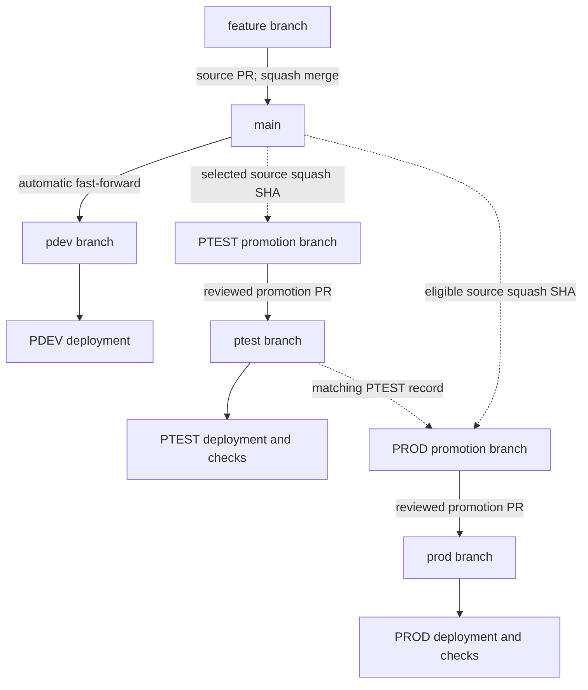
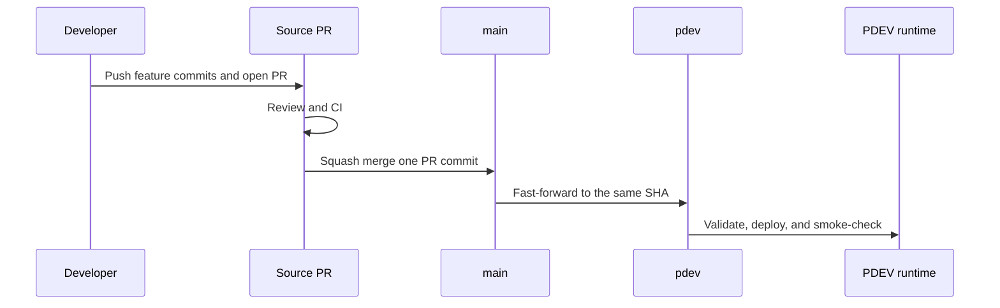
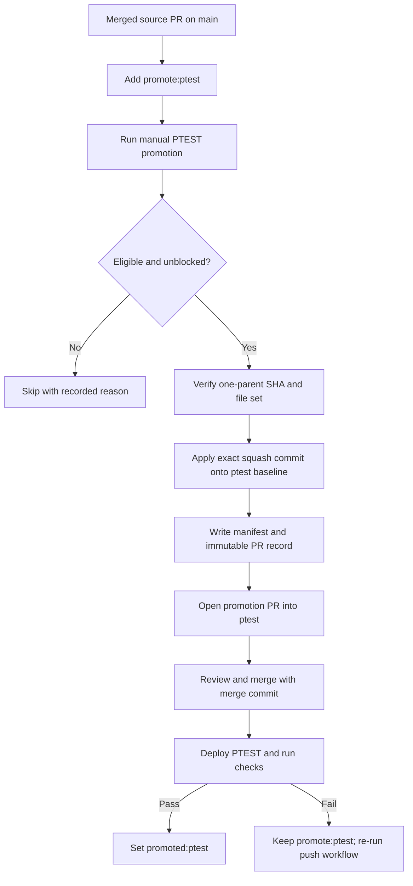
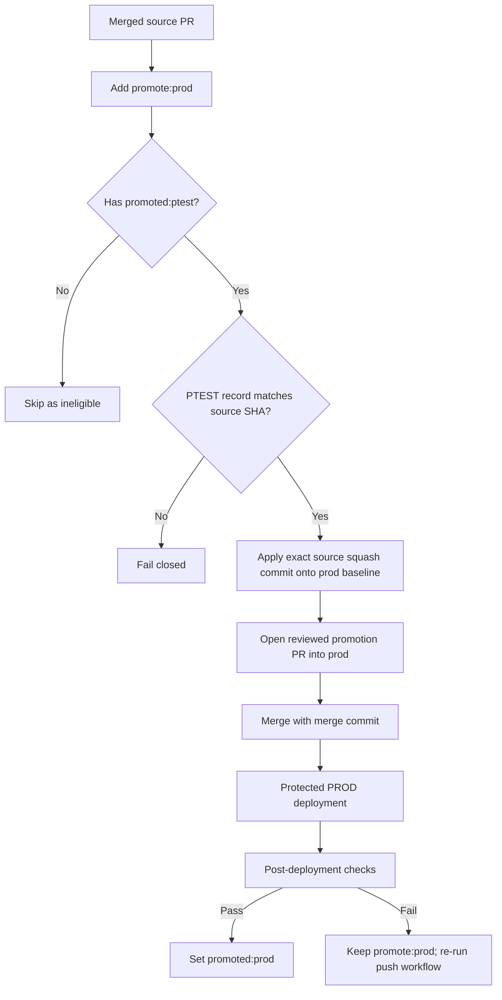
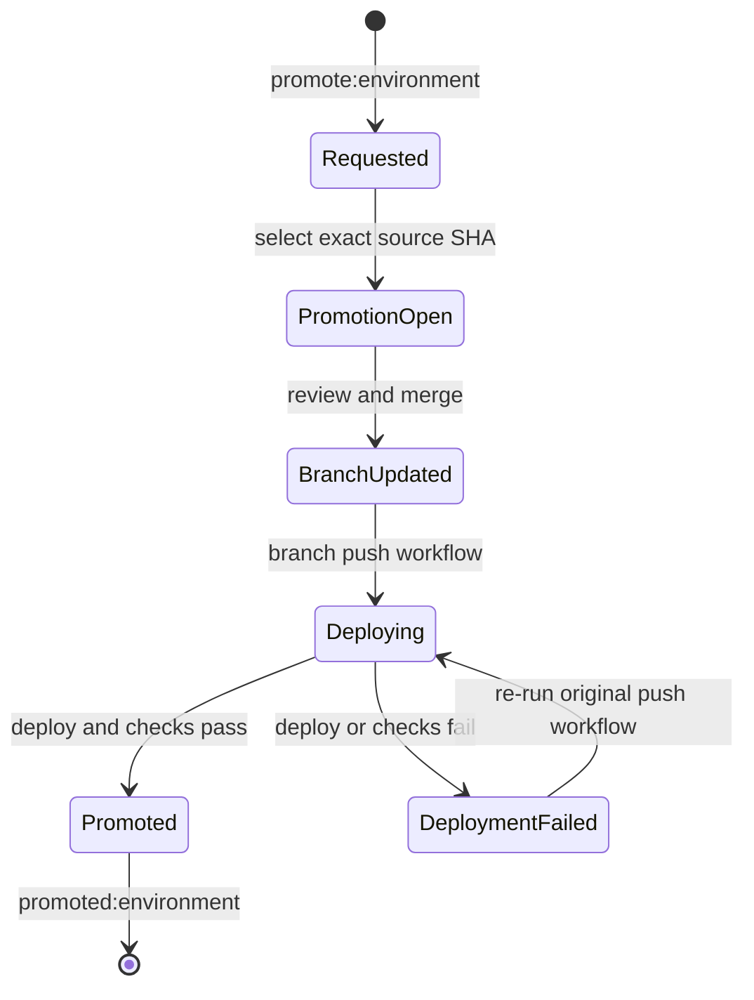
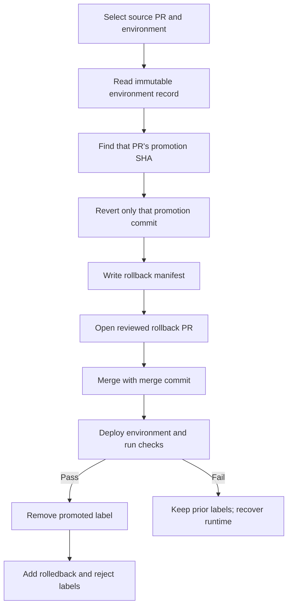

# GitHub PR-label promotion demo

This repository is a working template for selectively promoting Airflow DAG changes through:

`feature/* -> main -> pdev -> ptest -> prod`

`main` is the integration branch. Every source PR merged to `main` is automatically deployed to PDEV. PTEST and PROD receive only the exact squash commits belonging to eligible labeled source PRs.

## Strategy decision

Do **not** merge `main` or `pdev` into `ptest` or `prod`. Those integration branches can contain several developers' changes, including changes not qualified for a higher environment. Instead:

1. Require **Squash and merge** for source PRs into `main`, so each source PR becomes one immutable commit.
2. A merge to `main` automatically fast-forwards `pdev` and deploys that exact SHA.
3. The manual PTEST workflow finds merged source PRs labeled `promote:ptest`, validates them, applies only their squash commits to a temporary branch based on `ptest`, and opens a promotion PR.
4. Merging the generated PR updates the `ptest` branch and triggers deployment. Only after deployment and post-deployment checks pass does automation replace `promote:ptest` with `promoted:ptest`.
5. The PROD workflow accepts only source PRs carrying both `promote:prod` and `promoted:ptest`, and verifies an immutable PTEST record for the same source SHA.
6. PROD uses the same selective-patch, reviewed-PR, deploy, verify, then label-finalize sequence.
7. Conflicts fail closed. Automation never resolves promotion or rollback conflicts silently.

This uses automated `git cherry-pick` only inside the promotion bot. Developers and release managers do not cherry-pick manually.

## Architecture diagrams

### 1. Overall branch and deployment architecture



PDEV contains all accepted `main` changes. PTEST and PROD contain selected patches only; neither higher branch receives an integration-branch merge.

### 2. Source PR through MAIN and PDEV



Squash merge collapses only the commits contained in that feature PR into one new `main` commit. It does not squash the repository's earlier history.

### 3. Selective promotion to PTEST



If `main` contains PR-A, PR-B, and PR-C but only PR-A and PR-C have `promote:ptest`, the generated PTEST branch applies only the squash SHAs for A and C. PR-B does not enter `ptest` merely because it exists in `main` or `pdev`.

### 4. Selective promotion to PROD



`promoted:ptest` is deployment evidence, not merge evidence: it is added only after the PTEST runtime deployment and checks succeed.

### 5. Correct post-deployment label timing



The generated environment PR being merged is not enough to claim successful promotion. `promoted:ptest` or `promoted:prod` means the target runtime was deployed and the configured post-deployment checks passed. A manual redeploy does not change source PR labels because it has no push range from which to identify newly merged manifests.

### 6. PR-specific rollback from PTEST or PROD



The rollback workflow reverts the exact `promotion_sha` recorded for that source PR in that environment. It does not reset the branch or remove unrelated PRs. If later changes depend on the reverted change, the revert may conflict or pass Git but fail tests; automation stops for review instead of guessing.

## What is and is not promoted

| Target | Input used by automation | Result |
| --- | --- | --- |
| PDEV | Current `main` SHA | All accepted integration changes are fast-forwarded and deployed. |
| PTEST | Eligible source PR squash SHAs with `promote:ptest` | Only selected patches are applied onto the current `ptest` baseline. |
| PROD | Eligible source PR squash SHAs with `promote:prod`, `promoted:ptest`, and a matching PTEST record | Only PTEST-qualified selected patches are applied onto the current `prod` baseline. |
| Rollback | One environment-specific recorded `promotion_sha` | Only that PR's promoted patch is reverted, subject to dependency/conflict checks. |

## Repository map

```text
.github/workflows/           CI, branch sync, promotion, rollback, and deployment workflows
dags/                        Sample Airflow DAG source
scripts/                     Promotion engine, validation, deployment checks, and packaging tools
tests/                       Unit tests for DAG, deployment, and promotion-policy logic
config/promotion-policy.json Branch, label, and promotion rules
.promotion/                  Promotion manifests and immutable per-PR records
docs/                        Setup, controls, rollback, and local demo guides
```

The two old PR-close finalization workflows are intentionally absent. `.github/workflows/deploy-environment.yml` now owns label finalization and invokes `scripts/finalize_deployment.py` only after the deployment adapter, post-deployment checks, and evidence upload succeed.

## Required GitHub configuration

Before running the workflows:

1. Push all four branches: `main`, `pdev`, `ptest`, and `prod`.
2. Require **Squash and merge** for feature PRs into `main`. Require **Create a merge commit** for generated promotion and rollback PRs into `ptest` and `prod`, so each PR-specific promotion or revert commit remains addressable.
3. Protect all four branches. Permit the promotion bot to update `pdev`; require PRs for `ptest` and `prod`.
4. Create GitHub Environments named `pdev`, `ptest`, and `prod`. Add required reviewers to `ptest` and `prod`.
5. Add a repository secret named `PROMOTION_BOT_TOKEN`. Use a short-lived GitHub App installation token in a real implementation. A fine-grained PAT is acceptable only for a disposable demo.
6. Give the bot access to repository contents, pull requests, issues/labels, and workflows as described in [docs/SETUP.md](docs/SETUP.md).
7. Run **Setup promotion labels** once.

The separate bot token is intentional. GitHub suppresses most new workflow runs for events created with the repository `GITHUB_TOKEN`; a promotion PR created with that token would not reliably trigger PR validation. The deployment workflow uses its own scoped `GITHUB_TOKEN` only to update labels and comments after successful deployment.

## Promotion labels

| Label | Meaning |
| --- | --- |
| `promote:ptest` | Request that the merged source PR be included in the next PTEST promotion batch. It remains until successful PTEST deployment. |
| `promoted:ptest` | The selected patch was deployed to PTEST and post-deployment checks passed. |
| `promote:prod` | Request production promotion. It is ignored until `promoted:ptest` and matching PTEST evidence exist. |
| `promoted:prod` | The selected patch was deployed to PROD and post-deployment checks passed. |
| `hold:ptest`, `hold:prod` | Temporarily exclude the PR from that environment. |
| `reject:ptest`, `reject:prod` | Explicitly block the PR from that environment. Rollback adds this to prevent accidental re-promotion. |
| `promotion:ptest`, `promotion:prod` | Automation-only labels on generated promotion PRs. |
| `rollback:ptest`, `rollback:prod` | Automation-only labels on generated rollback PRs. |
| `rolledback:ptest`, `rolledback:prod` | The rollback was deployed successfully to that environment. |

## Normal usage

```bash
git switch main
git pull
git switch -c feature/add-new-dag
# edit dags/ and tests/
git add dags tests
git commit -S -m "Add new DAG"
git push -u origin feature/add-new-dag
```

Open a PR into `main`, pass CI, and squash-merge it. PDEV synchronization and deployment are automatic.

For PTEST, add `promote:ptest` to the already merged source PR, then run **Promote selected PRs to PTEST**. Review and merge the generated PR into `ptest`. Wait for PTEST deployment to pass before expecting `promoted:ptest`.

For PROD, add `promote:prod` to the same source PR after PTEST succeeds, then run **Promote selected PRs to PROD**. Review and merge the generated PR into `prod`. Wait for PROD deployment to pass before expecting `promoted:prod`.

For a PR-specific rollback, run **Create selective rollback PR**, choose PTEST or PROD, and enter the original source PR number. The workflow reads the immutable promotion record and opens a reviewed revert PR against only that environment. Rollback labels change only after the rollback deployment succeeds.

If an environment PR merged but its push deployment failed, fix the deployment problem and use GitHub's **Re-run jobs** on that original push workflow run. Do not create another promotion PR for the same source patch. A `workflow_dispatch` redeploy validates runtime state but intentionally does not infer or finalize labels.

## Safety properties

- Moving branches are never used as the unit of selective promotion.
- Every selected source PR must be merged to `main` using one squash commit.
- The source PR file list must match the squash commit file list.
- The promoted patch ID must match the source patch ID.
- PROD requires a matching PTEST promotion record for the exact source SHA.
- Generated environment PRs preserve individual promotion commits by using merge commits rather than squash-merging the batch.
- Only one open promotion PR per target environment is allowed.
- Promotion and deployment jobs are serialized per environment.
- A conflict aborts the entire batch before anything is pushed.
- Deployments use protected GitHub Environments.
- Promotion and rollback labels are finalized only after deployment, smoke checks, and evidence upload succeed.
- Finalization processes only new, safe-path manifests added by the exact fast-forward push and verifies their promotion or revert SHAs are ancestors of the deployed SHA.
- Label/comment updates are idempotent, so re-running a failed workflow does not duplicate audit comments.
- Every promotion writes a manifest under `.promotion/runs/` and one immutable record per source PR under `.promotion/records/`.

See [docs/STRATEGY.md](docs/STRATEGY.md), [docs/SETUP.md](docs/SETUP.md), and [docs/ROLLBACK.md](docs/ROLLBACK.md) before adapting this template.
